# Interactive Residence, Building & Apartment Explorer

The explorer extends the existing Residences/Developments feature (see
[DEVELOPMENTS_SYSTEM.md](./DEVELOPMENTS_SYSTEM.md)). It is modelled on East Gate
Living B2: a full-bleed building rendering, apartment polygons coloured by
availability, a hover preview, a details drawer, and arrows to switch camera views.

Navigation: **Residence → Building → Building view (camera) → Apartment polygon →
Apartment drawer → existing listing** (when the unit has one).

| Public explorer | Apartment drawer | Phone bottom sheet |
| --- | --- | --- |
| 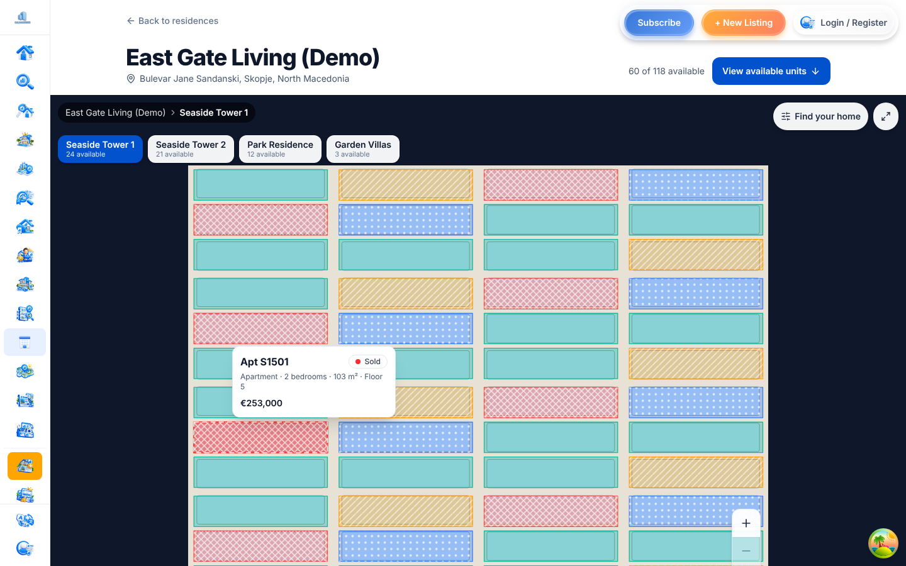 | 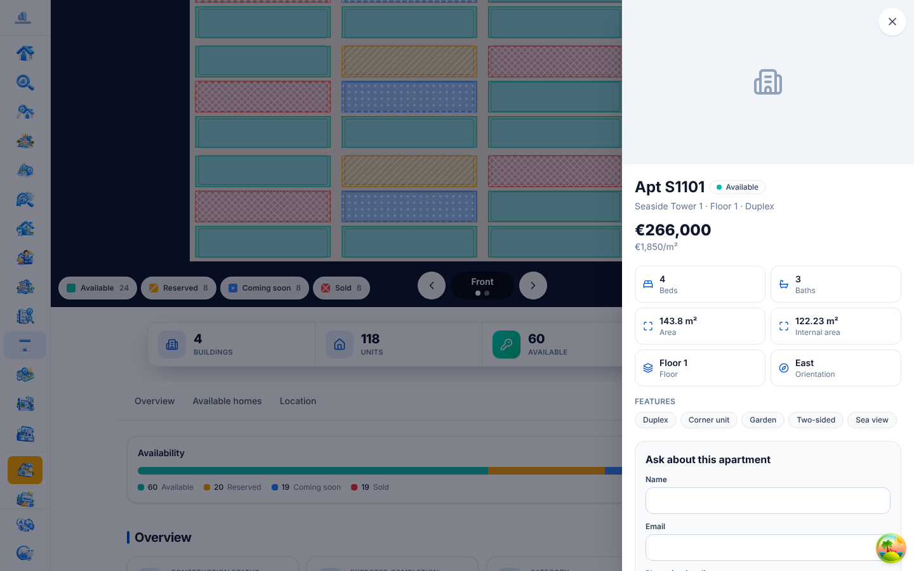 | 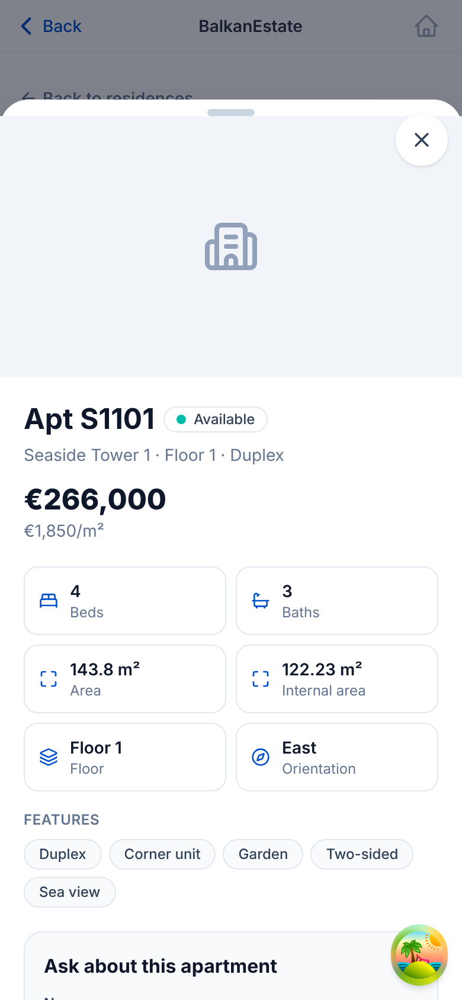 |

| Inventory | Unit editor | Region editor |
| --- | --- | --- |
| 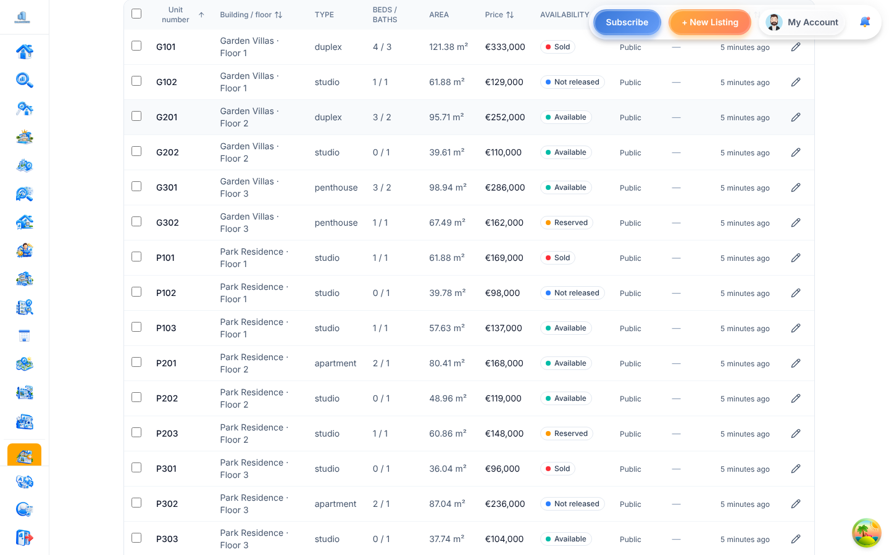 | 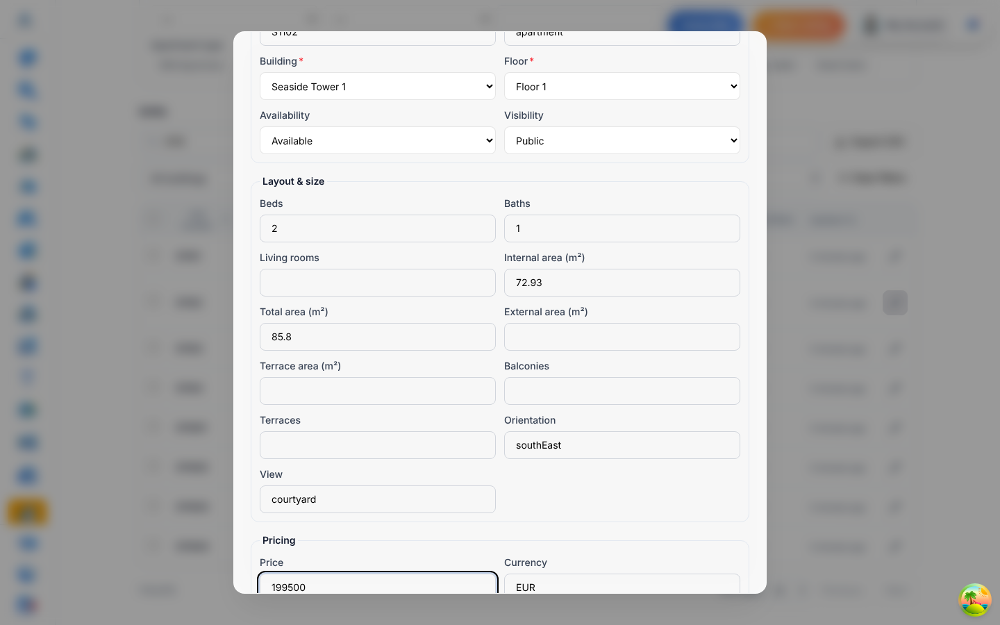 | 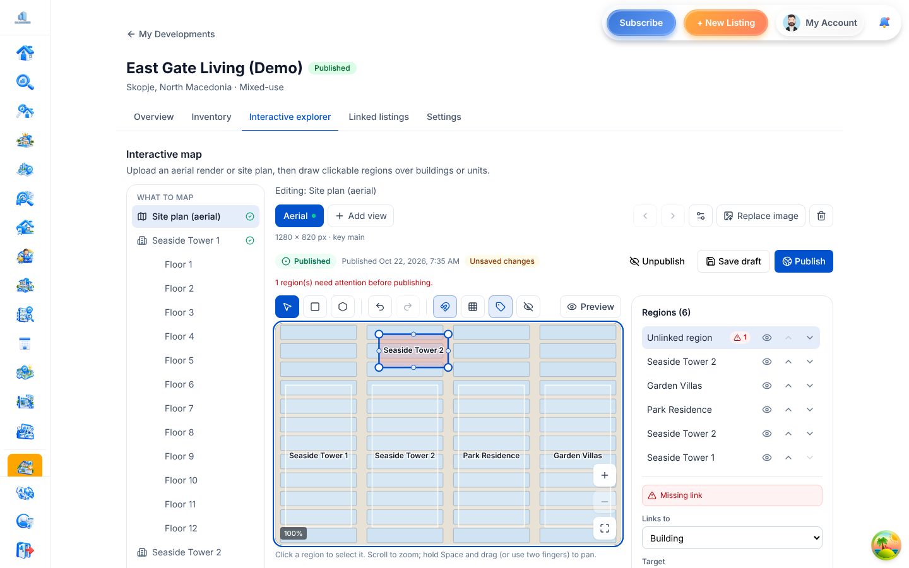 |

| Residence picture: building hover | Apartment hover card | Building without its own picture |
| --- | --- | --- |
| 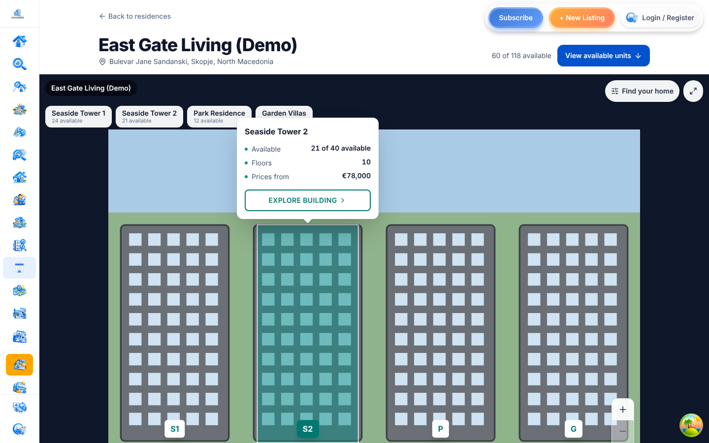 | 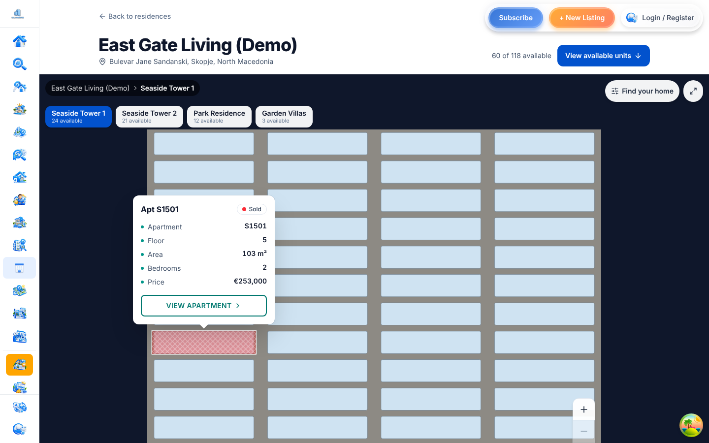 | 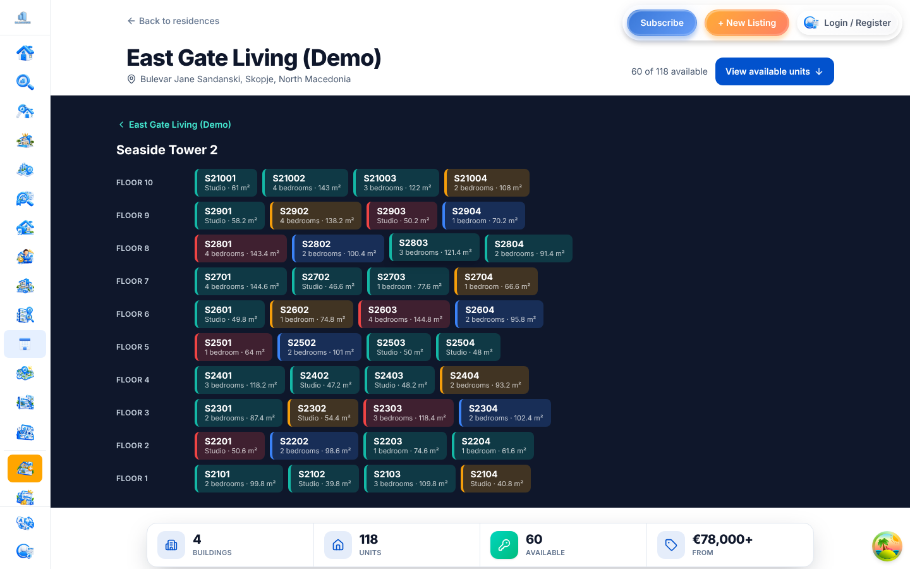 |

**How regions look.** By default (East Gate style) regions are invisible so the
rendering reads as a photo. The hovered or focused region lights up with a
translucent fill and a thin light outline: apartments in their availability
colour (available = teal), buildings in the brand teal. Units matching active
filters get a soft tint. The legend's **Show availability** switch colours every
apartment at once (with the colour-blind patterns); the choice is remembered per
browser. The styling lives in `components/public/explorer/regionPaint.ts`.

**Hover card.** Anchored to the region's top centre with an arrow, it lists:

- apartments: floor-plan preview, number, floor, area, bedrooms, price, status, **View apartment**
- buildings: available of total, floors, price from, **Explore building**

The pointer can move onto the card and press its button. On touch, the first tap
shows it.

**Residence picture.** Building regions on the residence (site plan) picture get
a name tag (the building's code, else its name) and open that building. A
building that has no picture of its own opens as a floor-by-floor grid of its
apartments, so every building can be opened. Entering a building adds a browser
history step, so Back returns to the residence.

**Zoom.** In the public explorer and the editor, Ctrl/⌘ + wheel or a pinch zooms.
When zoomed, the wheel or a two-finger swipe moves the picture in any direction
(Shift + wheel moves sideways), and dragging moves it too. In the editor, drag
on empty picture with the select tool; a drag that starts on a region still
edits that region.

Screenshots come from Playwright runs against the real app (Vite + Express +
MongoDB) with the demo seed. The sandbox could not reach picsum.photos, so the
building images are local placeholder drawings.

---

## 0. Concepts in one minute

| Thing | What it is | Where you manage it |
| --- | --- | --- |
| **Residence** (development) | The whole project, e.g. "East Gate Living" | Dashboard → My Developments |
| **Building** | One block of the residence | Inventory → Add buildings |
| **Floor** | A level of a building | Inventory → Add floors |
| **Unit** | One apartment of your inventory: number, floor, m², rooms, price, status | Inventory table / Edit unit |
| **Listing** | A marketplace ad on BalkanEstate (photos, description, contact) | Your normal listings |
| **View** (picture) | A picture of the residence, a building or a floor | Interactive explorer |
| **Region** | A shape drawn on a picture that links to one of the above | Interactive explorer |

A unit can have a listing **attached** (Linked listings tab): the apartment stays
in your inventory with its live status, and buyers can also open the listing.
Link a region to a **Listing** directly only for a listing that is not one of
this residence's apartments.

**Worked example (demo seed).** `cd backend && npm run seed:developments` (set
`DEV_SEED_EMAIL=` to choose the owner) creates "East Gate Living (Demo)":

| Where | Region | Links to | What a buyer sees |
| --- | --- | --- | --- |
| Residence picture | one per building (tags S1, S2, P, G) | Building | building card, then opens the building |
| Residence picture | "Example: standalone listing" | Listing | listing card: photo, price, m², floor, rooms |
| Seaside Tower 1 (front and back views) | one per apartment | Unit | apartment card; 3 apartments have a `[Demo]` listing attached |
| Park Residence (front) | one band per floor | Floor | floor card, then opens the floor plan |
| Park Residence, Floor 1 (plan) | one per apartment | Unit | apartment card |
| Seaside Tower 2 | (no picture) | n/a | opens as a floor-by-floor list |

Demo listings are titled `[Demo] …` and are replaced on every run. The seed (and `migrate:development-views`) connect with `MONGODB_URI`, the same variable as the server, falling back to `MONGO_URI` and then `mongodb://localhost:27017/balkan-estate`; the log line shows which one was used (password hidden). The
Interactive explorer tab also has a **How it works** panel, and the region
editor explains each link type under **Links to**.

| Listing region card | Building → floors | In-editor guide |
| --- | --- | --- |
| 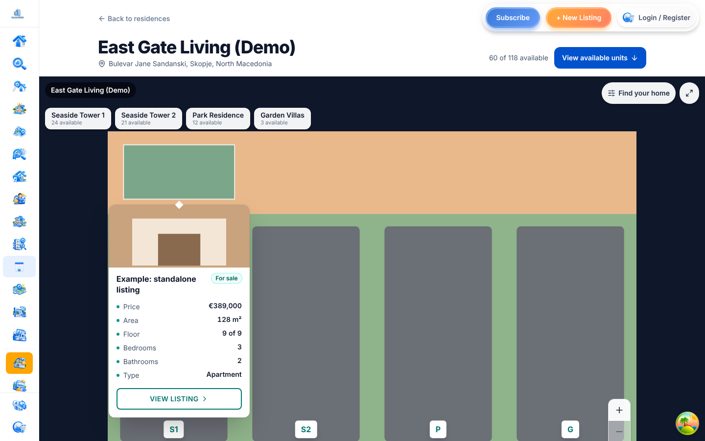 | 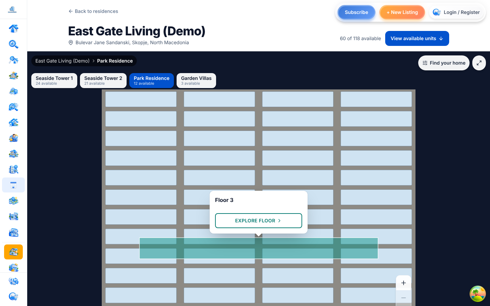 | 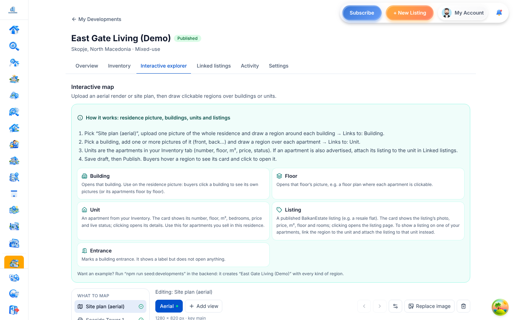 |

## 1. Architecture

**Data.** A *view* is a `DevelopmentScene`: one camera perspective of a target,
which is the development (site plan), a building or a floor. A target can have many
views, keyed by `viewKey`. Each view stores the image, its pixel size, a **draft**
and a **published** snapshot of hotspots, and a version counter.

A hotspot is a polygon or rectangle in normalised 0–1 image coordinates. It links
to a unit, building, floor, entrance or listing.

**Availability.** The listing status is the source of truth. Effective
availability is the *most restrictive* of the unit's declared state and its
non-draft linked listings:

- active → available
- pending → reserved
- sold → sold
- rented → rented

Draft listings are ignored. The rule lives in
`backend/src/services/developments/unitAvailability.ts`. The explorer, the public
API, the dashboard and the CSV export all use it.

**Geometry.** Polygon validation is implemented twice, once on each side, and both
copies are tested against the same fixture
(`src/features/developments/utils/__fixtures__/polygon-cases.json`):

- client: `utils/polygonGeometry.ts`
- server: `services/developments/hotspotGeometry.ts`

The server **rejects** invalid shapes and never clamps them. It rejects:

- more than 20,000 points across one view (checked first, keeping each save bounded)
- non-finite numbers
- points out of bounds
- fewer than 3 or more than 200 points
- duplicate points
- self-intersecting shapes
- zero-area shapes

**Backend layers.** Controllers are thin; logic lives in
`services/developments/`:

| Service | Responsibility |
| --- | --- |
| `developmentSceneService` | views, draft/publish/unpublish, link validation, public views |
| `unitAdminService` | dashboard list, PATCH with field-level authz, delete, bulk, CSV, floorplan, building/floor edits |
| `developmentPublicService` | public projections (strip internals, hide hidden units, price-on-request, effective availability) |
| `unitInquiryService` | inquiries for units without a listing |
| `developmentAudit` | `recordDevelopmentAudit` + `diffFields` for every mutation |

**Frontend.** All of it lives in `src/features/developments/`:

| Area | Location |
| --- | --- |
| Public explorer | `components/public/explorer/` (stage, canvas, tooltip, legend, view switcher, building chips) |
| Apartment drawer | `components/public/explorer/drawer/` |
| Region editor | `components/scene/editor/` with `hooks/usePolygonEditor.ts` (reducer, undo/redo) and `hooks/useEditorViewport.ts` |
| Dashboard | `components/dashboard/` (tabbed manage page, inventory table, unit edit dialog, linked listings, settings) |
| URL / pan-zoom hooks | `hooks/usePanZoom.ts`, `hooks/useExplorerUrlState.ts`, `hooks/useUnitDrawer.ts` |

**Platform reuse.** The drawer reuses the platform's existing components rather
than copying them:

- `PropertyInquiryModal` and `ScheduleViewingModal`
- favourites (`toggleSavedHome`) and compare (`ADD_TO_COMPARISON`)
- `SocialShare`, `ImageViewerModal`, `FloorPlanViewerModal`
- `useProperty` for the unit's primary listing

Only a unit **without** a listing uses the new unit inquiry form.

## 2. Database changes (all additive)

| Collection | Change |
| --- | --- |
| `developmentscenes` | `viewKey`, `viewName` (≤80), `viewDirection`, `sortOrder`. Unique index `scene_per_target_view_unique` on (developmentId, targetType, targetId, viewKey) with partial filter `{deletedAt: null}`. |
| `developmentunits` | `visibility` (public/hidden), `priceVisibility` (public/on_request), `livingRooms`, `externalArea`, `terraceArea`, `description`, `floorplan{url,publicId,width,height}`, `gallery[]` (≤30), `features[]`, plus an index on `{developmentId, visibility}`. |
| `developments` | `allowUnitInquiries` (default `true`). |
| `inquiries` | type `'development'` plus optional `developmentId` / `unitId` refs and an index. Existing inquiry flows are unchanged. |
| `developmentauditlogs` | new actions: `unit.update/delete/bulk_update`, `price.change`, `floor.create/update`, `building.update`, `scene.upload/update/draft/publish/unpublish/delete`. |

**Migration.** Run `cd backend && npm run migrate:development-views` (supports
`DRY_RUN=true`). It:

- backfills `viewKey=main`, `viewDirection=front` and `sortOrder=0`
- drops the legacy `scene_per_target_unique` index
- reports duplicates
- creates the new indexes

It is idempotent: a second run changes nothing. It uses `createIndexes`, not
`syncIndexes`, so it never drops indexes it doesn't know about.

**Rollback.** Every new field is optional, and the old `/:slug/scene` endpoint
still works.

## 3. Endpoints

**Public** (`/api/developments`, no auth). The development must be published, or
the endpoint returns 404.

| Method & path | Notes |
| --- | --- |
| `GET /:slug` | Public projection. No `ownerId`, `agencyId` or media publicIds. Buildings include `stats{units, available}`. |
| `GET /:slug/units` | Visible units only, with effective availability. `priceOnRequest` hides price and price/m². Only non-draft listing ids, encoded. |
| `GET /:slug/units/:unitId` | Unit + development + sanitised listings. 404 for a hidden unit. |
| `GET /:slug/views?targetType&targetId` | Published views only. Hotspots are filtered to visible units, live buildings and floors, and non-draft listings. |
| `GET /:slug/scene` | Legacy: the `main` (or lowest `sortOrder`) published view. |
| `POST /:slug/units/:unitId/inquiries` | `{name, email, phone?, message}`, rate limited to 30/h. Returns 403 `inquiries_disabled` when the development turned inquiries off. |
| `GET/POST/DELETE /:slug/follow` | Published developments only. |

**Dashboard** (`/api/dashboard/developments/:developmentId`, auth +
`developmentAuth`). Every id is resolved inside this development, encoded ids
included; anything else returns 404.

| Method & path | Permission |
| --- | --- |
| `GET /units?search&buildingId&floorId&availability&visibility&hasListing&ids&sort&limit≤200&skip` | member |
| `PATCH /units/:unitId` | field-level: price fields → `price.change`, `availability` → `availability.change`, everything else → `unit.manage` |
| `DELETE /units/:unitId` (soft) | `unit.manage` |
| `POST /units/:unitId/gallery` (multipart `images`, ≤10 per upload, ≤30 per unit) | `media.upload` |
| `DELETE /units/:unitId/gallery/:index`, `DELETE /units/:unitId/floorplan` | `unit.manage` |
| `GET /audit?limit≤100&skip&action` (exact action or family prefix such as `price`) | `team.manage` |
| `POST /units/bulk {unitIds≤500, availability?, visibility?}` | `availability.change` / `unit.manage` |
| `GET /units/export.csv` | member |
| `POST /units/:unitId/floorplan` (multipart `floorplan`) | `unit.manage` |
| `PATCH /buildings/:id`, `PATCH /floors/:id` | `building.manage` / `floor.manage` |
| `POST /scenes` (multipart `image` + target + view fields) | `scene.edit` (+ `media.upload`, checked in the service) |
| `PATCH /scenes/:id` (name, direction, order) | `scene.edit` |
| `PATCH /scenes/:id/draft {hotspots, baseVersion}` | `scene.edit`. Returns 409 `version_conflict` and 400 `errors: HotspotIssue[]` when they apply. |
| `POST /scenes/:id/publish`, `/unpublish` | `publish` (rate limited) |
| `DELETE /scenes/:id` | `scene.edit` |

**Rate limiting.** Mutations use `mutationRateLimiter` and uploads use
`uploadRateLimiter`.

**Uploads.** Accepted types are jpeg, png, webp and avif, up to 10 MB. SVG is
refused.

## 4. Permissions

The role matrix is in `backend/src/config/developments.ts` (`ROLE_PERMISSIONS`).
The frontend has a copy in
`components/dashboard/inventory/permissions.ts`, used **only** to disable controls;
the server always decides.

| Role | Can do |
| --- | --- |
| owner | everything |
| manager | everything except `ownership.transfer` |
| sales_manager | units, prices, availability, listings |
| sales_agent | availability and listings |
| editor | project fields, units, scenes |
| viewer | read-only |

## 5. How to

**Create the demo:** sign up in the app, then run:

```bash
cd backend && npm run seed:developments
```

The seed uses the most recent user; set `DEV_SEED_EMAIL=` to pick another. It
creates 4 buildings and 118 units, a site plan view, and a front and back view for
Seaside Tower 1.

**A demo with real renders — Plaza Tirana:**

```bash
cd backend && npm run seed:plaza
```

It creates "Plaza Tirana (Demo)" from the renders in `public/demo/plaza/`:

| Picture | Regions link to |
| --- | --- |
| Residence: *Square* and *From the east* aerials | Plaza Tower, Plaza Podium |
| Plaza Tower: *Front* | each apartment (84; duplexes cover two floors, penthouses two columns) |
| Plaza Tower: *Floors* | each floor (22 bands) |
| Plaza Podium | no picture: the floor-by-floor list of 6 shops and 8 offices |

Units are deterministic (same data every run): studios to 4-bedroom penthouses,
with areas, orientation, view, features, prices per m², availability that sells
lower floors first, a floor plan on the duplexes, and four `[Demo Plaza]`
listings (three apartments for sale, one office for rent). The outlines live in
`backend/src/scripts/demo/plazaGeometry.ts` (pixels of each render) and the units
in `plazaUnits.ts`; both seeds share `demo/seedSupport.ts`. Pictures are served by
the web app, so set `PUBLIC_WEB_URL` if it does not run on `http://localhost:3000`.

| Residence picture | Plaza Tower front |
| --- | --- |
| 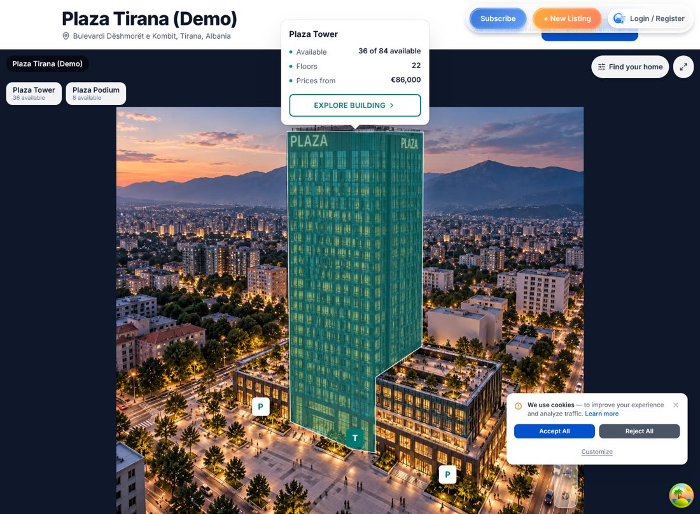 | 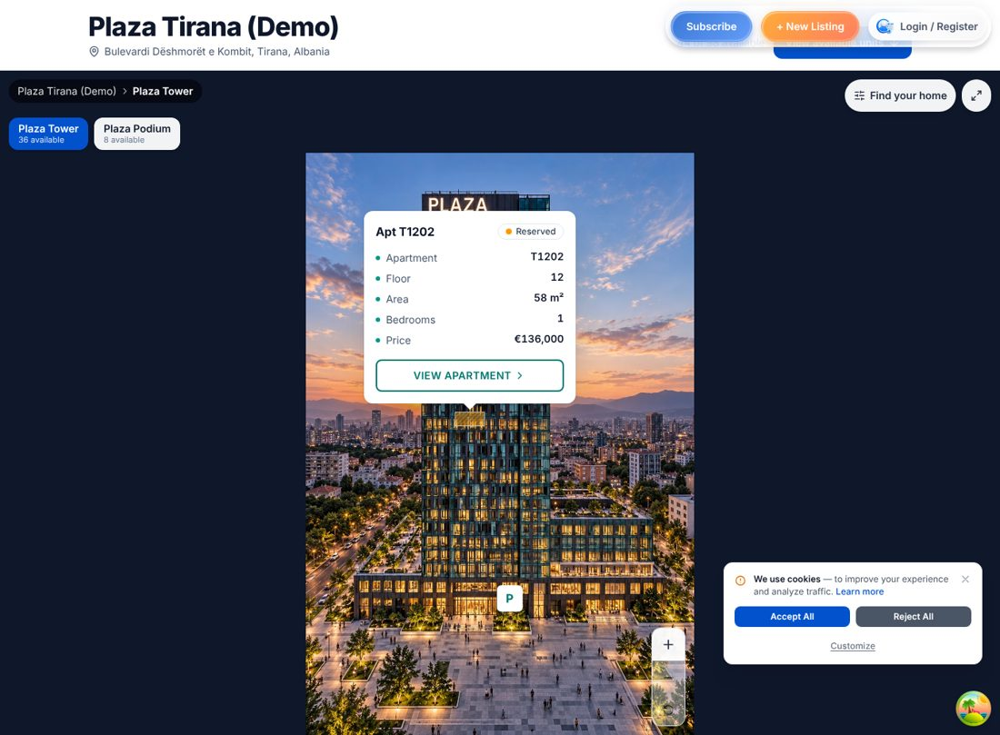 |

**Add a building view:**

1. Dashboard → residence → **Interactive explorer**.
2. Pick the building, then **Add view**.
3. Upload the image, name it and choose a direction.

The view key is derived from the name. If you replace an image with a different
aspect ratio, you'll be offered **Clear regions**.

**Draw apartments:**

1. Choose **Polygon** (or **Rectangle**).
2. Click points; close the shape by clicking the first point, pressing **Enter**,
   or using **Finish**.
3. Pick the unit under **Target**, then **Save draft** → **Publish**.

| Action | How |
| --- | --- |
| Undo / redo | Ctrl/Cmd+Z, Shift+Ctrl+Z |
| Delete point or region | Delete |
| Nudge | Arrow keys (Shift ×10) |
| Duplicate | D |
| Add a point | Double-click an edge dot |
| Zoom / pan | Wheel; Space+drag |

New regions start unlinked. Saving and publishing are blocked until every region
is valid and linked.

**Fill a unit from one of your listings:** Inventory → **Edit unit** (or the
*Add units* form) → **Fill from one of your listings**. Pick a listing and its
type, rooms, areas, price (sale listings only — a monthly rent is not copied),
orientation, view, description and features fill the form, and its floor is
chosen when the building has that level. Review, then save; **Undo** restores
the form. Tick *Also link this listing to the unit* and it is attached on save
(the same conflict checks as Linked listings). Only listings you control can be
read (`GET …/listings/:listingId/unit-prefill`, `unitPrefillService.ts`).

**Fixed choices and euros:** unit type, orientation (8 directions, the same as
listings) and view are dropdowns; the server accepts only those orientation and
view values (`unitRules.ts`, used by edit, create and import). All residence
prices are in euros: there is no currency field, new and imported units are
stored in EUR, and any other currency is rejected with a clear message.

**Hide a unit or its price:** Inventory → **Edit unit** → *Visibility* or *Price
shown to buyers*.

**Edit the residence (name, location, amenities, contact):** **Details &
settings** tab → *Residence details*. Country and city use the same dropdowns as
the create form; picking a city fills the coordinates, and the map below them
(the listing form's location picker) lets you drag or click the pin. Coordinates
are shown with 6 decimals, prices as `136.000 €` and areas as `82 m²`, the same
as on listing pages (`utils/format.ts`). The phone uses the app's phone input
(dial code preselected from the country). Only changed fields are sent, and the
server re-validates them (website must be http(s); contact email must be valid;
at most 40 amenities of 60 characters each). Owners and admins (`project.edit`)
can save; others see the form read-only.

**Completed residences:** set the stage to *Completed* and the form asks for
the **Year built** instead of an expected completion date. The server keeps
only the one that fits the stage (`timelineFor`), and the public page shows
"Year built 2019" / "Built 2019" instead of "Expected completion".

**Attach a listing while creating or editing it:** after the listing is saved,
the location step shows nearby residences. **Choose apartment** puts the listing
on an apartment (it then shows on that apartment in the explorer); **Link to the
residence only** links it without an apartment. The panel shows where the
listing is attached today ("On apartment T1203 · Plaza Tower"), also after a
reload. If you can't manage the residence, **Request access** asks its owner.

**"Part of <residence>" on listing pages:** a listing attached to a published
residence shows a banner linking to its apartment in the explorer
(`GET /api/developments/for-listing/:listingId`; nothing for drafts, hidden
apartments or unpublished residences).

**Import a whole building from a spreadsheet:** Inventory → **Import from
spreadsheet**. Drop an Excel workbook (.xlsx; pick the worksheet if it has
several) or a CSV (any separator; Excel's `;` works), or start from **Download
template** — one row per apartment. Old binary .xls files are explained (save
as .xlsx). Excel is read in the browser by `read-excel-file`, loaded only when
an .xlsx is chosen. Columns can be in any order
and in English, Albanian or BCMS ("Zgrada / Objekti", "Sprat / Kati", "Stan /
Banesa", "Kvadratura / Sipërfaqja", "Cijena / Çmimi", "Status"…); you can change
what each column is used for. Values are read as people write them: floors
"Prizemlje", "Përdhese", "B1", "Kati 3"; numbers "45.000 €", "64,5"; availability
"Slobodno", "e lirë", "Prodato"; types "Garsonjera", "Lokal"; features "Terasa,
Parking". Without a floor column, floors come from unit numbers (401 → 4);
without a building column, all rows go to the building you name. Before
anything is written, the server's dry run shows new buildings, floors and units,
updates, and every row that will be skipped and why. Missing buildings and
floors are created; existing units are updated with only the columns the file
has (or left alone, if you untick it). Same permissions as manual edits; at most
2,000 rows per import; recorded in Activity. Our own **Export CSV** imports back
unchanged. Code: `utils/csvImport/` (reading and mapping),
`services/developments/unitImportService.ts` (`POST …/units/import`).

**Add floors and units quickly:** Inventory → *Add buildings, floors and units*.
The level starts at the next free one for the building and moves on after each
add; leave the label empty and the floor is named for you ("Floor 4", "Ground
floor" for 0, "Basement 1" for -1). Fill *To level* to add a whole range at once
(existing levels are skipped). Unit numbers are suggested per floor ("401,
402…", or continuing the floor's own pattern such as "T1205") and *How many*
adds several in one go. The rules live in `utils/inventoryNaming.ts`.

**Turn off inquiries for units without a listing:** **Details & settings** tab.

**Add apartment photos or remove a floor plan:** Inventory → **Edit unit** →
*Photos* / *Floorplan*. Changes save immediately.

**See who changed what:** **Activity** tab (owners and managers), filterable by
units, prices, explorer, listings and structure.

| Activity | Unit photos |
| --- | --- |
| 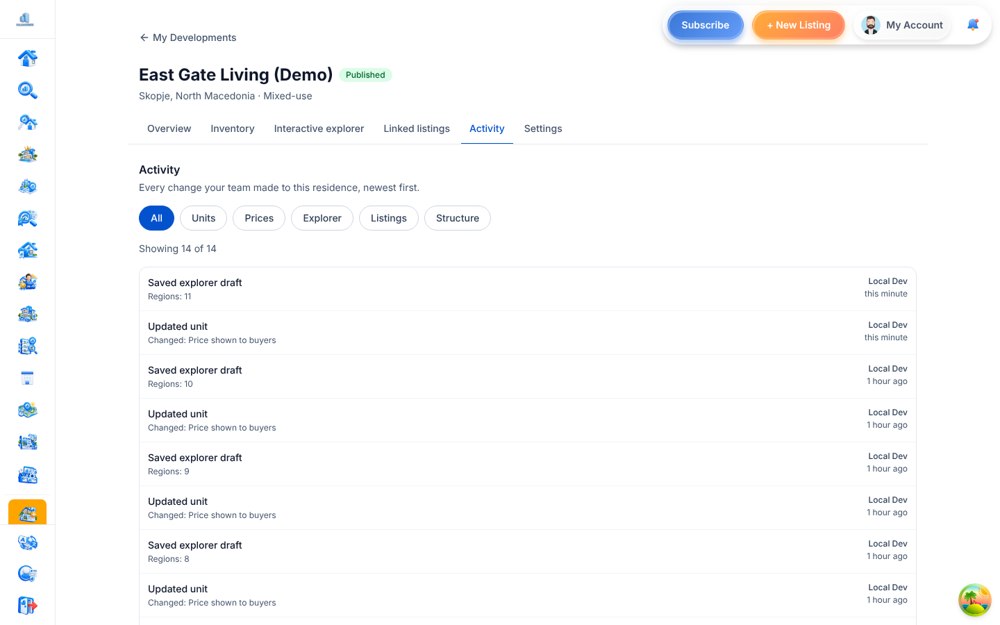 | 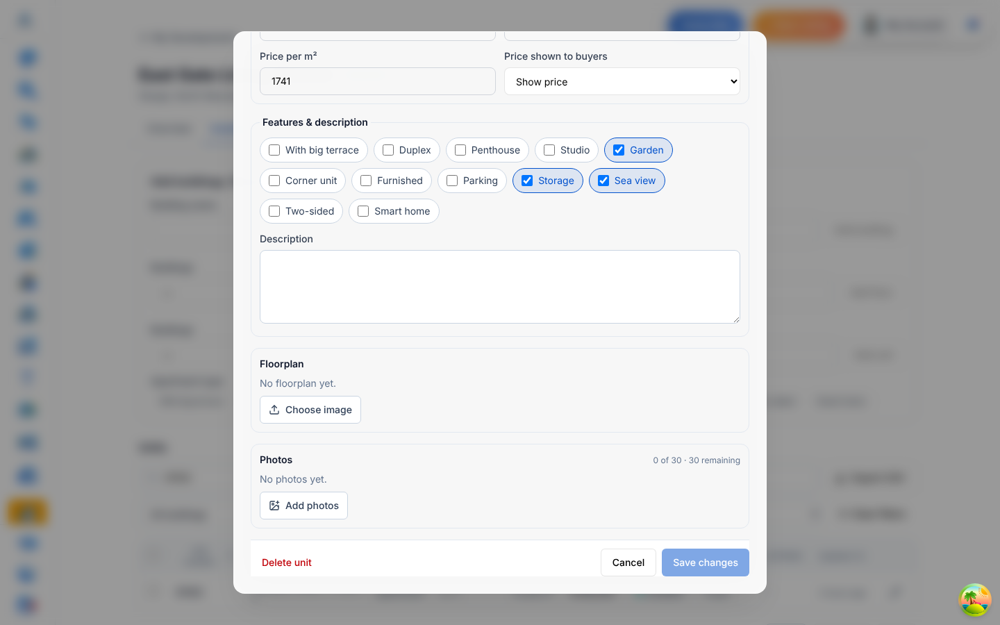 |

## 6. Storage configuration

Images go through `backend/src/services/mediaService.ts` to Cloudflare R2. Set
these variables:

- `R2_ACCOUNT_ID`
- `R2_ACCESS_KEY_ID`
- `R2_SECRET_ACCESS_KEY`
- `R2_BUCKET`
- `R2_PUBLIC_URL` (plus `R2_ENDPOINT` / `R2_PRIVATE_BUCKET` if used)

Without them, scene, cover and floorplan uploads return a clear "Image storage is
not configured" error. Floorplans use the existing `development-scene` media kind.

## 7. Tests (actually run, on this branch)

| Suite | Command | Result |
| --- | --- | --- |
| Backend developments (real `mongod` via MongoMemoryServer system binary) | `cd backend && NODE_OPTIONS=--max-old-space-size=8192 MONGOMS_SYSTEM_BINARY=/usr/local/bin/mongod npx jest --runInBand --testPathPattern developments` | 20 suites, **193 passed** |
| Frontend developments + i18n keys | `npx vitest run src/features/developments src/tests/i18n-keys.test.ts` | 24 files, **168 passed** |
| E2E (Playwright, real backend + Vite + seeded MongoDB) | `CHROME_PATH=… E2E_DEV_EMAIL=… E2E_DEV_PASSWORD=… npx playwright test e2e/residence-explorer.spec.ts` | **6 passed**, 6 skipped by design (each flow runs on either desktop or mobile) |
| Backend typecheck | `cd backend && npx tsc --noEmit` | clean |
| Frontend typecheck | `npx tsc --noEmit -p .` | 0 errors in `src/features/developments`; the repo has unrelated existing errors elsewhere |
| Production build | `npx vite build --mode production` | success |

**Backend jest** covers:

- field-level authz
- cross-development ids → 404
- encoded ids
- hidden units and price-on-request in the public API
- draft listing ids never exposed
- follow on a draft development → 404
- cross-tenant detach
- CSV formula injection
- unit inquiry (happy path, disabled, hidden unit, validation)
- multiple views per building and `viewKey` conflicts
- hotspot geometry and link rejection
- version conflicts, including 5 concurrent saves → exactly one wins
- publish re-validation and unpublish
- the legacy scene endpoint

`security-review-fixes.test.ts` pins the findings of an adversarial review of
these endpoints, each fixed on this branch:

- `/nearby` used to return owner ids and storage keys
- public stats counted hidden units
- follower price filters matched on-request prices
- `request-attachment` revealed draft developments
- creating a unit could set price/availability without `price.change` / `availability.change`
- `agencyId` on create wasn't checked against the caller
- a draft had no total vertex cap; publish had no rate limit
- CSV cells could carry formulas after a `;` separator
- negative `limit`/`skip` on the public list
- `javascript:` websites were accepted
- email template values expanded `$`-patterns

The attach preview also now hides other people's listing details.

**E2E** covers:

- residence → building drill-in, view switching, hover preview
- drawer open via `?unit=`, closed with browser Back
- a real unit inquiry (201)
- URL-synced legend filter
- the phone tap-preview → bottom sheet
- inventory edit to price-on-request, checked against the public API
- a polygon drawn in the editor saved at the drawn coordinates

## 8. Known limitations

**Data and storage**
- The jest suites run against a standalone `mongod`, so they exercise the
  no-transaction fallback of `withOptionalTransaction`. The transactional path is
  used on replica sets.
- Hard-deleted listings are detached from units automatically (Property
  `deleteOne` / `findOneAndDelete` / `deleteMany` hooks). Raw driver writes that
  bypass Mongoose would skip this; reads still ignore missing listings.

**Platform and security**
- Platform `GET /api/properties/:id` serves draft listings to anyone with the id.
  This is outside the explorer (which never exposes draft listing ids); fixing it
  needs the seller's edit flow to load drafts with authentication, so it is left
  as a separate task.
- The dashboard `GET /:developmentId` still returns the full document, including
  `ownerId`, to authorised members.

**Editor and dashboard**
- Hotspots linked to a unit that was later hidden are kept in the draft and
  filtered out of the public views, so hiding a unit never blocks the editor.
- Server-side unit search matches the unit number only.

**Public explorer**
- Images are plain 2D renders. A Google Earth fly-in or 3D models are not part of
  this build.
